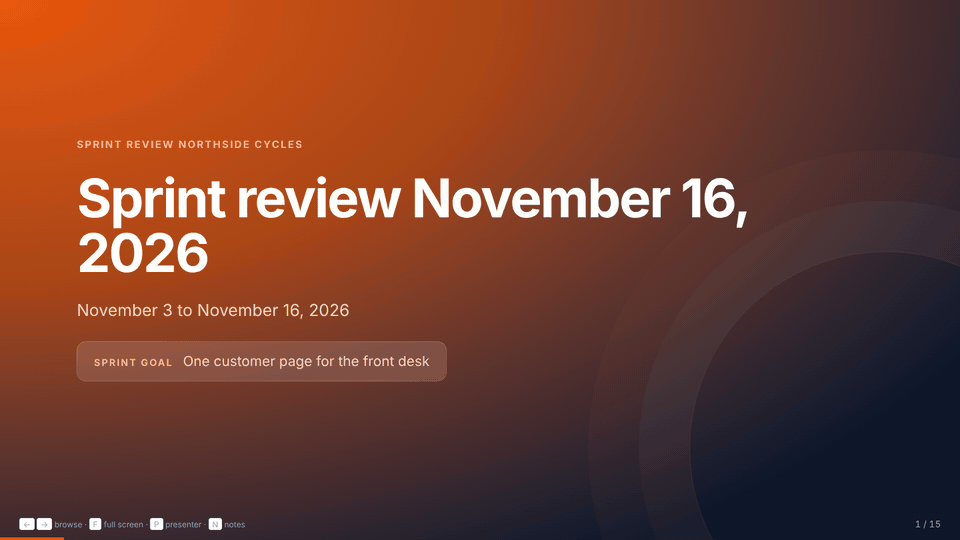

<p align="center">
  <a href="https://guuskeunen.github.io/sprint-review/">
    <picture>
      <source media="(prefers-color-scheme: dark)" srcset="docs/assets/logo-dark.svg">
      
    </picture>
  </a>
</p>

<p align="center">
  <b>Turn a sprint's git history into a review deck anyone can follow.</b><br>
  AI writes the words. Code checks every claim. You click publish.
</p>

<p align="center">
  <a href="https://www.npmjs.com/package/@guuskeunen/sprint-review"></a>
  <a href="https://github.com/marketplace/actions/sprint-review-deck"></a>
  <a href="docs/integrations.md#claude-code-cursor-and-other-mcp-clients"></a>
  <a href="LICENSE"></a>
  
</p>

<p align="center">
  <a href="https://guuskeunen.github.io/sprint-review/"><b>Website</b></a> ·
  <a href="https://guuskeunen.github.io/sprint-review/demo/"><b>Live demo deck</b></a> ·
  <a href="docs/getting-started.md"><b>Get started</b></a>
</p>

<p align="center">
  
</p>

---

Every sprint, someone spends half a day turning commit messages like `refactor(planner): optimize status count queries` into slides that marketing, sales and management actually understand. **sprint-review does that in about a minute**, and builds a polished deck with the before and after screenshots, the roadmap and the speaker notes.

```bash
export ANTHROPIC_API_KEY=sk-ant-...
npx @guuskeunen/sprint-review
```

That's all you need to start: no config, no account, nothing to host. You get a single HTML deck that opens anywhere.

## Why it's different

Most AI summary tools hand your history to a model and hope for the best. sprint-review treats the model as a writer, not a source of truth:

- **Every point has to name a real commit.** A point that points nowhere is dropped. That's how invented features stay off the slides.
- **Code does everything that can be checked.** Word limits, no ticket numbers or hashes, no exclamation marks, the numbers, the pictures, the page itself. The model never writes HTML or counts anything.
- **A second AI reads it like your audience would.** It sees only the slide text and flags whatever someone outside the team wouldn't understand. Those lines are rewritten once, and the rewrite has to pass every check again.
- **Tooling never becomes a theme.** CI, test and dependency changes go under the hood automatically.
- **Real screenshots, no customer data.** It reuses the pictures your visual tests already take (or photographs your staging pages, with private bits masked), finds the screens that actually changed, and crops to the change.
- **Nothing is published on its own.** You get a draft, the check log and an editable `review.json`.

## What you get

| File | What it is |
|---|---|
| `deck.html` | The presentation. One self-contained file: arrow keys, presenter window with notes and timer, full screen, prints to PDF. |
| `review.json` | Everything on the slides. Edit it, then `sprint-review render` rebuilds the deck. |
| `review.md` | A Markdown summary for a pull request, Slack or an email. |
| `checks.md` | What the checks corrected, moved or dropped, and what the second reader flagged. |
| `deck.pptx` | Optional (`--pptx`): the same deck as an editable PowerPoint, with speaker notes. |

The deck has a cover with your logo and color, *What we gain* grouped by value, usage numbers, a summary, one slide per theme (with a screenshot when one fits), before and after slides, the roadmap, *Under the hood* and a closing slide.

## Quick start

```bash
# 1. In your repository
npx @guuskeunen/sprint-review init      # writes sprint-review.config.yml

# 2. See what it will read, for free
npx @guuskeunen/sprint-review --dry-run

# 3. Write the review
export ANTHROPIC_API_KEY=sk-ant-...
npx @guuskeunen/sprint-review
open sprint-reviews/*/deck.html
```

More options:

```bash
sprint-review --since 2026-11-03 --until 2026-11-16   # a date range
sprint-review --from v1.4.0 --to v1.5.0              # between two tags
sprint-review edit sprint-reviews/2026-11-16/review.json   # editor beside the live deck
sprint-review render sprint-reviews/2026-11-16/review.json # rebuild after a hand edit
sprint-review --pptx --slack                          # also PowerPoint, and post to Slack
sprint-review capture                                 # photograph your staging pages
sprint-review doctor                                  # check the setup
```

→ **[Getting started guide](docs/getting-started.md)**

## Run it every sprint with GitHub Actions

```yaml
name: Sprint review
on:
  schedule:
    - cron: '0 7 * * 5'   # the morning of review day
  workflow_dispatch:

jobs:
  review:
    runs-on: ubuntu-latest
    steps:
      - uses: actions/checkout@v4
        with:
          fetch-depth: 0            # the full history is needed
      - uses: guuskeunen/sprint-review@v0
        id: review
        with:
          anthropic-api-key: ${{ secrets.ANTHROPIC_API_KEY }}
      - uses: actions/upload-artifact@v4
        with:
          name: sprint-review
          path: ${{ steps.review.outputs.dir }}
```

The review also lands in the job summary. Want a pull request to review and a shareable link on GitHub Pages instead? → **[GitHub Action guide](docs/github-action.md)**

## Use it from Claude Code, Cursor or any MCP client

```bash
claude mcp add sprint-review -- npx -y @guuskeunen/sprint-review mcp
```

Then ask *"make our sprint review for the last two weeks"*. There's also a [Claude Code skill](skills/sprint-review/SKILL.md). → **[Integrations](docs/integrations.md)**: MCP, OpenAI, Slack, pull requests, GitLab

## Configuration at a glance

```yaml
product:
  name: Spoke
  description: the planning and customer app of a chain of bike repair shops
organization: Northside Cycles
audience: business          # business, executives, customers, team, or your own words
language: English           # or Dutch, German, nl, de-DE …
sprint: { days: 14 }
brand: { color: "#ea580c", logo: ./logo.png }   # or: brand: { from: our-template.pptx }
productPaths: [src/]
screenshots:
  source: git
  dir: e2e/__screenshots__
  ignore: { left: 240, top: 64 }
```

→ **[Full configuration reference](docs/configuration.md)**

## Documentation

- [Getting started](docs/getting-started.md): from zero to your first deck in five minutes
- [Configuration](docs/configuration.md): every option, with defaults
- [Screenshots](docs/screenshots.md): before and after slides from your visual tests, a folder, or captured from URLs
- [GitHub Action](docs/github-action.md): scheduled reviews, pull requests, GitHub Pages, Slack, GitLab
- [Editing and presenting](docs/editing.md): the editor, presenting, PDF and PowerPoint
- [Integrations](docs/integrations.md): MCP server, Claude Code skill, Slack, pull request context
- [Models and providers](docs/models.md): Claude, Bedrock, Azure, OpenAI, OpenRouter, Gemini, Mistral, Ollama, LM Studio
- [Security and privacy](docs/security.md): what it reads, what it sends where, what it never does
- [How it works](docs/how-it-works.md): the pipeline and every check
- [Using it as a library](docs/library.md): the Node API
- [Troubleshooting](docs/troubleshooting.md) and [FAQ](docs/faq.md)
- Guides: [How to run a sprint review](docs/guides/how-to-run-a-sprint-review.md) · [Sprint review template](docs/guides/sprint-review-template.md)

## Privacy and cost

- **What leaves your machine:** commit subjects, bodies and file names of the sprint, pull request titles and descriptions when a GitHub token is set, plus your product description, sent to the AI provider you choose with your own key. **Never source code, never screenshots.** No sprint-review server, no telemetry. With a local model (Ollama, LM Studio) nothing leaves your network at all. → **[Security and privacy](docs/security.md)**
- **What it costs:** two or three API calls per review, billed to your own account. `--dry-run` shows how many tokens a review will use before you spend anything. Pick a smaller model in the config if you want it cheaper.

## Roadmap

- [x] CLI, GitHub Action, deck, Markdown summary, check log
- [x] Before and after screenshots from git, a folder, or captured from URLs
- [x] English and Dutch slide labels, any language for the content
- [x] Pull request descriptions as extra context
- [x] One automatic revision pass for lines the second reader flags
- [x] Brand from an existing deck: color, fonts and logo from a `.pptx`
- [x] PowerPoint export with speaker notes
- [x] Local editor (`sprint-review edit`)
- [x] GitLab CI template, Slack posting
- [x] More models: Bedrock, Azure, OpenAI, OpenRouter, Gemini, Mistral, Ollama, LM Studio
- [x] MCP server and Claude Code skill
- [ ] Linked issues (GitHub, Jira, Linear) as extra context
- [ ] Export into your own PowerPoint layouts, not just its look
- [ ] More slide languages built in

Ideas and bugs: [open an issue](https://github.com/guuskeunen/sprint-review/issues).

## Contributing

PRs welcome. See [CONTRIBUTING.md](CONTRIBUTING.md). `npm test` runs the whole pipeline against a fake repo and a fake model, so you don't need an API key.

## License

[MIT](LICENSE) © Guus Keunen. Icons from [Lucide](https://lucide.dev) (ISC).
